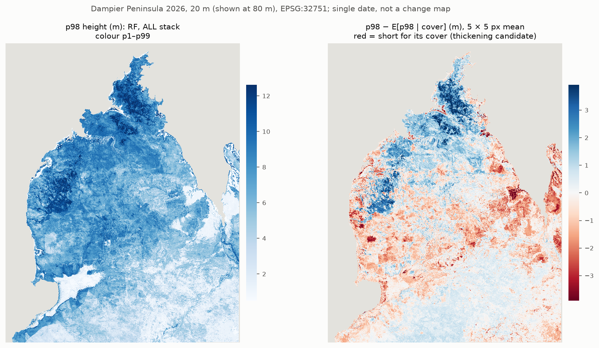

# Dampier Peninsula vegetation structure, 2026
Summary of results from our drone LiDAR sampling trip to the Dampier Peninsula, Australia.

**Results site: https://grshennan.github.io/Dampier_2026_woody_thickening_results/**

Where is vegetation tall or short for its canopy cover?

- Drone LiDAR at 5 Dampier sites (2026) and 7 Yawuru areas (2025) gives 39,023 training pixels (20 m).
- A 49-feature image stack (NISAR L-band, Sentinel-1, Sentinel-2) predicts height and cover (random forest).
- **p98 residual** = p98 height − expected p98 height for the pixel's cover.
  Negative: shorter, denser. Positive: taller, more open.
- K-fold R² 0.47 per pixel, 0.83 for a 5 × 5 pixel (100 m) mean. Single date: not a change map.

This repo holds the site, its figures and tables, and the scripts that made them.
Map rasters: not yet available.
Paths in the code (`G:\`, `E:\`) are the authors' drives; the input data are not in this repo.
